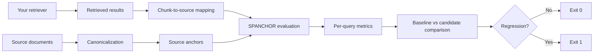

<div align="center">


# SPANCHOR

**Source-anchored regression testing for RAG retrieval pipelines.**

[](https://pypi.org/project/spanchor/)
[](https://pypi.org/project/spanchor/)
[](LICENSE)
[](https://github.com/Mukeshram-07/spanchor/actions/workflows/ci.yml)
[](https://github.com/Mukeshram-07/spanchor/actions/workflows/release.yml)

```bash
pip install spanchor
```

</div>

Detect retrieval regressions when chunking, indexing, ranking, or retrieval configurations change, using stable source-document evidence instead of fragile chunk IDs.

[GitHub](https://github.com/Mukeshram-07/spanchor) · [PyPI](https://pypi.org/project/spanchor/) · [Changelog](CHANGELOG.md)

[Why SPANCHOR](#why-spanchor) · [Quick start](#60-second-quick-start) · [Metrics](#metrics) · [Set-wise metrics](#set-wise-metrics) · [Framework integrations](#framework-integrations) · [CI](#use-spanchor-as-a-ci-regression-gate) · [CLI](#cli) · [Documentation](#documentation)

---

## Why SPANCHOR?

Retrieval evaluation is often tied to chunk IDs or chunk boundaries. Change the chunk size and the labels no longer line up, so you cannot tell whether retrieval got better or worse.

**Traditional evaluation**

```
Question → expected chunk ID → retrieved chunk ID → pass/fail
```

Re-chunking invalidates the gold labels.

**SPANCHOR**

```
Question → expected source span → retrieved text → source-span overlap
         → per-query metrics → regression decision
```

The canonical source document is the stable reference point. Documents are normalized (NFC Unicode, `\n` line endings) and hash-validated, so an anchor that no longer matches its source fails loudly instead of silently drifting.

With SPANCHOR you can change your chunker, index, retriever, or reranker and still measure whether the same source evidence is being retrieved, query by query.

## Who is SPANCHOR for?

SPANCHOR is useful if you:

- build RAG systems and change chunking or retrieval strategies
- evaluate retrievers or rerankers
- maintain retrieval benchmarks
- want retrieval regression tests in CI
- use LangChain, LlamaIndex, or a custom retrieval stack
- need source-evidence-level evaluation rather than fragile chunk-ID comparisons

## How it works

1. **Anchor** expected evidence to character spans in canonical source documents.
2. **Map** retrieved chunk text back to those source spans (or pass spans directly).
3. **Score** each query: Recall@K, Precision@K, Hit@K, FullEvidence@K, IoU, plus `retrieved_chars` and three set-wise structural diagnostics (see [Metrics](#metrics)).
4. **Compare** a baseline run against a candidate run under a per-metric policy.
5. **Gate** CI on the result.



SPANCHOR sits after retrieval: **RAG pipeline → retrieval → SPANCHOR → regression gate → CI decision.**

## Key features

- **Source-anchored evaluation**: gold labels point to spans in canonical documents
- **Character-level span metrics**: Recall@K, Precision@K, Hit@K, FullEvidence@K, IoU
- **Set-wise structural diagnostics**: `span_concentration`, `fragmentation_ratio`, `pairwise_overlap`, recorded by `evaluate()` (descriptive, not quality scores; see [Set-wise metrics](#set-wise-metrics) for current limits)
- **Per-query regression detection** with configurable per-metric thresholds
- **Baseline vs candidate comparison** with markdown reports (CLI and Python) and JSON comparison reports (Python)
- **Optional bootstrap confidence intervals** for metric deltas (Python API only)
- **Run fingerprints**: `corpus_hash` and `gold_set_hash` are stored with each run, with optional gold-set hash mismatch checks
- **Adapters**: generic dicts, LangChain, LlamaIndex
- **CLI** for validate, evaluate, compare, locate, check-corpus, anchor add, and gold extract / gold review
- **CI exit codes** for pass, regression, usage error, and unmapped-chunk-rate failures
- **Local-first and deterministic**: no network access or API keys required
- **Typed Python API**: checked with `mypy --strict` (with adapter-module overrides in `pyproject.toml`)

## Installation

```bash
pip install spanchor                 # core library and CLI
pip install "spanchor[langchain]"    # + LangChain adapter dependencies
pip install "spanchor[llamaindex]"   # + LlamaIndex adapter dependencies
```

The LangChain and LlamaIndex integrations are optional extras and are not installed by default. Requires Python 3.11 or newer (tested on 3.11, 3.12, 3.13).

## 60-second quick start

```python
from spanchor import Anchor, Document, Query, compare, evaluate
from spanchor.adapters.generic import dicts_to_retrieval_results
from spanchor.canonical.normalize import compute_hash

# 1. Canonical source document
text = "CloudSync is a cloud storage service. It syncs files across devices."
doc = Document.from_text("doc1", text)

# 2. Anchor the expected evidence to a source span
evidence = "CloudSync is a cloud storage service."
start = text.index(evidence)
anchor = Anchor("doc1", start, start + len(evidence), compute_hash(evidence))

# 3. Define the query
query = Query("q1", "What is CloudSync?", (anchor,))

# 4. Convert retrieval results (chunk text from any retriever)
baseline_results = {"q1": dicts_to_retrieval_results([{"text": evidence, "score": 0.9}])}
candidate_results = {"q1": dicts_to_retrieval_results([{"text": "It syncs files across devices.", "score": 0.9}])}

# 5. Evaluate both configurations
documents = {"doc1": doc}
baseline = evaluate(documents, [query], baseline_results, k=5)
candidate = evaluate(documents, [query], candidate_results, k=5)
print(baseline.aggregate_metrics["mean_recall@5"])  # 1.0

# 6. Compare per query against a policy (max allowed drop per metric)
result = compare(baseline, candidate, policy={"recall@5": 0.05})

# 7. Detect the regression
print(result.has_regression)      # True
print(result.per_query_status)    # {'q1': 'REGRESSION'}
```

Results given as chunk text (no `document_id`, no offsets) are mapped to source spans automatically. If you already know the source span, pass `document_id`, `start`, and `end` instead.

A gold set with only a handful of queries triggers a low-confidence warning; real gold sets should be larger.

## Regression example

A benchmark snapshot from this repository: 100 gold queries over 4 technical documents (`examples/real_world_validation/`).

| | Baseline | Candidate |
|---|---|---|
| Chunk size | 250 | 200 |
| Overlap | 0 | 50 |
| Recall@5 | **0.405** | **0.249** |

```
Regressions:  19 queries exceeded the configured threshold
Status:       FAIL
Exit code:    1
```

To reproduce it, run `python run_validation.py` from `examples/real_world_validation/` (it rewrites `baseline.json` and `candidate.json` in that directory and exits with code 1 on regression).

This is a measured historical snapshot from the included validation assets, not a hypothetical. It is specific to this corpus and these configurations; it demonstrates the regression-testing mechanism and is not a general claim about chunk size or overlap.

## Metrics

| Metric | Meaning |
|---|---|
| **Recall@K** | Fraction of gold-evidence characters covered by the top-K retrieved spans |
| **Precision@K** | Fraction of retrieved characters that overlap gold evidence |
| **Hit@K** | Whether at least one gold span is covered by at least 50% (default `min_overlap`) |
| **FullEvidence@K** | Whether every gold span is covered by at least 50% |
| **IoU** | Intersection-over-union between retrieved and gold characters (diagnostic) |
| **retrieved_chars** | Characters in the union of the top-K retrieved spans (cost proxy, reported only) |

Per-query keys are `recall@K`, `precision@K`, `hit@K`, `full_evidence@K`, `iou`, and `retrieved_chars`, with `K` filled in (for example `recall@5`). Policies and `ComparisonResult` use these per-query keys. The three [set-wise metrics](#set-wise-metrics) are recorded alongside them.

**Aggregate metrics** (macro-averaged by default, prefixed `mean_`, for example `mean_recall@5`) are for reporting and trending.
**Per-query metrics** are what the regression gate uses. Each query is classified as `IMPROVED`, `UNCHANGED`, or `REGRESSION` against the policy, and any single `REGRESSION` fails the comparison. An aggregate improvement does not cancel an individual query regression. Metrics that are not listed in the policy are reported but never gate.

### Set-wise metrics

Three structural diagnostics describe *how* the retrieved spans are laid out, independent of the gold evidence and of rank order. They are descriptive, not quality scores: a higher or lower value is not inherently better. Each is computed per document and then averaged across documents, so offsets from different documents are never mixed. All three return `0.0` when there are no spans, and `fragmentation_ratio` and `pairwise_overlap` also return `0.0` for fewer than two spans.

| Metric | Meaning |
|---|---|
| `span_concentration` | Share of the merged retrieved coverage that sits in the single largest contiguous region (1.0 = one block) |
| `fragmentation_ratio` | `(fragments - 1) / (results - 1)`, where fragments is the number of disjoint regions after merging (0.0 = everything merges into one region, 1.0 = every result is separate) |
| `pairwise_overlap` | Mean over all result pairs of `intersection / min(span length)` (high values indicate redundant results) |

Set-wise values reach you in two ways, which have different requirements.

**1. Recorded by `evaluate()` (works in the normal workflow).** The default metric registry includes the three metrics, so `evaluate()` stores them in `Run.per_query_metrics` and, as `mean_...` keys, in `Run.aggregate_metrics`. They are written to saved run JSON, appear in `ComparisonResult.per_query_deltas` and `aggregate_deltas`, and show up in the per-query and aggregate tables of the markdown comparison report. They do not affect the regression decision unless you add them to the policy, and since the policy treats any drop beyond its threshold as a regression, gating on a descriptive metric is rarely meaningful. Two caveats apply:

- Values are computed over all retrieved results for a query, not only the top K.
- They are meaningful only for results supplied in span form (`document_id`, `start`, `end`). For chunk-text results that SPANCHOR maps itself, `evaluate()` currently records `0.0` for all three, so the quick start above shows zero set-wise deltas.

**2. `compare(..., include_setwise=True)` (opt-in, Python only, needs extra setup).** This computes set-wise deltas from the retrieval results stored on the two `Run` objects and fills two `ComparisonResult` fields:

- `ComparisonResult.setwise_deltas`: per-query deltas (candidate minus baseline), `{query_id: {metric: delta}}`
- `ComparisonResult.setwise_aggregate_deltas`: macro-average of those deltas per metric, `{metric: delta}`

Neither field affects `has_regression` or `per_query_status`. Both are `None` when `include_setwise` is `False` (the default) or when either run lacks `per_query_retrieval_results`.

> **Limitation:** `evaluate()` does not populate `Run.per_query_retrieval_results`. The workflow `evaluate()` then `compare(..., include_setwise=True)` therefore returns `setwise_deltas=None` and `setwise_aggregate_deltas=None` on its own. Set-wise comparison requires **both** `Run` objects to carry `per_query_retrieval_results`, which you must attach yourself, as below. Saved run JSON does not store them, and the CLI has no set-wise option, so `spanchor compare` never produces this output.

```python
from dataclasses import replace

from spanchor import Anchor, Document, Query, RetrievalResult, compare, evaluate
from spanchor.canonical.normalize import compute_hash

text = "CloudSync is a cloud storage service. It syncs files across devices. It supports sharing."
evidence = "CloudSync is a cloud storage service."
documents = {"doc1": Document.from_text("doc1", text)}
query = Query("q1", "What is CloudSync?", (Anchor("doc1", 0, len(evidence), compute_hash(evidence)),))


def spans(*offsets):  # span-form results: document_id + start + end
    return [
        RetrievalResult(rank=i, score=1.0, document_id="doc1", start=s, end=e)
        for i, (s, e) in enumerate(offsets, start=1)
    ]


baseline_results = {"q1": spans((0, 37), (37, 70))}
candidate_results = {"q1": spans((0, 20), (40, 60), (70, 85))}

baseline = evaluate(documents, [query], baseline_results, k=5)
candidate = evaluate(documents, [query], candidate_results, k=5)

# evaluate() leaves per_query_retrieval_results as None, so attach it to both runs.
baseline = replace(baseline, per_query_retrieval_results={q: tuple(r) for q, r in baseline_results.items()})
candidate = replace(candidate, per_query_retrieval_results={q: tuple(r) for q, r in candidate_results.items()})

result = compare(baseline, candidate, policy={"recall@5": 0.05}, include_setwise=True)
print(result.setwise_deltas)            # {'q1': {'span_concentration': -0.636..., 'fragmentation_ratio': 1.0, 'pairwise_overlap': 0.0}}
print(result.setwise_aggregate_deltas)  # same values, keyed by metric
```

Only results that carry `document_id`, `start`, and `end` are used in this path; chunk-text-only results contribute no spans. When set-wise data is present, `generate_comparison_report()` (in `spanchor.reporting.markdown`) adds a `## Set-wise Metrics` section with aggregate deltas (the Baseline and Candidate columns show `N/A`) and per-query rows where any delta exceeds 0.01 in absolute value. `generate_comparison_json()` (in `spanchor.reporting.json_report`) adds `setwise_aggregate_deltas` and `per_query_setwise_deltas`.

## Framework integrations

All adapters return SPANCHOR `RetrievalResult` lists, ready for `evaluate()`.

**Generic**: `dict_to_retrieval_result()` and `dicts_to_retrieval_results()` accept common field aliases (`text`/`chunk`/`content`/`body`, `score`/`similarity`, and others).

```python
from spanchor.adapters.generic import dicts_to_retrieval_results

results = dicts_to_retrieval_results([{"text": "retrieved chunk", "score": 0.95}])
```

**LangChain** (`pip install "spanchor[langchain]"`)

```python
from spanchor.adapters.langchain import documents_to_retrieval_results

docs = retriever.invoke("your query")           # list of LangChain Documents
results = documents_to_retrieval_results(docs)  # score_key / document_id_key are configurable
```

**LlamaIndex** (`pip install "spanchor[llamaindex]"`)

```python
from spanchor.adapters.llamaindex import nodes_to_retrieval_results

nodes = retriever.retrieve("your query")        # list of NodeWithScore
results = nodes_to_retrieval_results(nodes)
```

## Use SPANCHOR as a CI regression gate

```
Baseline retrieval run
        ↓
Candidate retrieval run
        ↓
spanchor compare
        ↓
Policy thresholds
        ↓
PASS / FAIL
```

```bash
spanchor evaluate docs/ gold.jsonl baseline_results.json  -o baseline.json
spanchor evaluate docs/ gold.jsonl candidate_results.json -o candidate.json
spanchor compare baseline.json candidate.json --policy policy.json --report comparison.md
```

`policy.json` sets the maximum allowed per-query drop for each metric:

```json
{"recall@5": 0.05, "precision@5": 0.05, "hit@5": 0.1}
```

| Exit code | Meaning |
|---|---|
| `0` | Success, or no regression (`compare`) |
| `1` | Regression detected (`compare`) |
| `2` | Schema, usage, or validation error |
| `3` | Unmapped chunk rate exceeded (`evaluate`) |

`RESULTS_PATH` is a JSON object mapping each `query_id` to a list of results; each result has a `rank`, a `score`, and either `text` (chunk-text form) or `document_id`, `start`, and `end` (span form). `--max-recall-drop` and `--max-precision-drop` override the `recall@5` and `precision@5` entries of the policy. The CLI has no flags for set-wise comparison or confidence intervals, and `spanchor compare` writes markdown reports only.

## CLI

| Command | Purpose |
|---|---|
| `spanchor validate DOCS_DIR GOLD_PATH` | Validate every anchor against its source document |
| `spanchor evaluate DOCS_DIR GOLD_PATH RESULTS_PATH` | Compute metrics (`--k`, `--output`, `--report`, `--max-unmapped-rate`, `--gold-set-hash`, `--corpus-mismatch-policy`, `--redact`) |
| `spanchor compare BASELINE CANDIDATE` | Per-query regression comparison (`--policy`, `--report`, `--max-recall-drop`, `--max-precision-drop`, `--redact`) |
| `spanchor locate TEXT DOCS_DIR` | Find text in documents and print anchor offsets and hash |
| `spanchor check-corpus DOCS_DIR GOLD_PATH` | Check anchor hashes, bounds, and text against the corpus |
| `spanchor anchor add QUERY_ID QUESTION DOCS_DIR TEXT` | Add a validated anchor to a gold JSONL file (`--gold`, `--occurrence`) |
| `spanchor gold extract DOCS_DIR -o CANDIDATES` | Extract candidate sentences from documents for gold-set bootstrapping |
| `spanchor gold review CANDIDATES_FILE -c ID` | Approve, reject, or edit a candidate (`--approve`, `--reject`, `--question`, `--source-start`, `--source-end`, `--output`) |

Run `spanchor <command> --help` for full options.

## Real-world validation and adoption demo

[`examples/real_world_validation/`](examples/real_world_validation/README.md) is a runnable benchmark: 100 gold queries over 4 documents, a baseline and a candidate retriever, and a regression that fails the gate.

```bash
cd examples/real_world_validation
python run_validation.py
```

[`examples/demo/`](examples/demo/README.md) is a small CLI walkthrough with a gold set (validate, evaluate, compare, locate, anchor add).

[`examples/adoption_demo/`](examples/adoption_demo/) is out of date: its `run_demo.py` still asserts package version 0.2.0 and fails on current releases.

## Documentation

| Resource | Purpose |
|---|---|
| [Adoption demo](examples/adoption_demo/README.md) | Integrating SPANCHOR into a retrieval pipeline (outdated, see above) |
| [Real-world validation](examples/real_world_validation/README.md) | 100-query benchmark and regression scenario |
| [Minimal demo](examples/demo/README.md) | Small CLI walkthrough with a gold set |
| [Changelog](CHANGELOG.md) | Release history |

## Release and versioning

- **Current release:** `v0.4.0` (see `pyproject.toml` and [CHANGELOG.md](CHANGELOG.md)). Note that `spanchor.__version__` still reports `0.3.0`; the installed package metadata (`pip show spanchor`) reports `0.4.0`
- **Versioning model:** `0.x.y` indicates alpha/early-stage development; breaking changes may occur between minor versions before `1.0.0`
- **Python support:** 3.11, 3.12, 3.13
- **Benchmark note:** benchmark values shown in this README are corpus-specific snapshots and should be treated as validation examples, not universal performance claims

## Scope

SPANCHOR is an evaluation layer. It does not:

- retrieve documents
- generate embeddings
- chunk documents
- generate answers
- host a vector database
- parse PDFs or run OCR
- provide an LLM
- replace a RAG framework

It is designed to sit next to whichever of these you already use.

## Known considerations and limitations

- SPANCHOR is an alpha/early-stage project; APIs and integration surfaces may evolve.
- Dependency specifiers are intentionally broad in `pyproject.toml`; use locked environments for reproducible development/testing.
- Source anchors are tied to canonicalized document content. If source documents are revised, anchors/gold sets should be reviewed and versioned with the corpus.
- Very small or noisy gold sets can produce false-positive regressions for individual queries; treat regression policies as quality gates that still need human review.
- SPANCHOR evaluates retrieval evidence overlap and regression behavior. It does not determine source authority/trustworthiness or answer correctness.
- Set-wise comparison (`compare(..., include_setwise=True)`) works only when both `Run` objects carry `per_query_retrieval_results`. `evaluate()` does not set it, saved run JSON does not store it, and the CLI cannot request it. See [Set-wise metrics](#set-wise-metrics).
- The set-wise values that `evaluate()` records are computed over all retrieved results (not only the top K) and are `0.0` for chunk-text results that SPANCHOR maps itself.
- A result with `text` and `document_id` but no offsets is currently neither mapped nor scored. Pass either `text` alone, or `document_id` with `start` and `end`.
- Bootstrap confidence intervals and JSON comparison reports are Python API features. Promoting reviewed gold candidates is also Python only (`spanchor.generation.promote.promote_candidate_to_gold`); there is no `gold promote` CLI command.

## Development

```bash
git clone https://github.com/Mukeshram-07/spanchor.git
cd spanchor
pip install -e ".[dev]"

pytest
mypy --strict src/spanchor
ruff check src/spanchor --select E,W,F,I --ignore B008,E501
ruff format src/spanchor tests --check

pip install build && python -m build
```

Notes:
- `pip install -e ".[dev]"` matches CI and includes the core test/quality toolchain.
- Dev dependencies include pinned `ruff==0.1.6`; `uv.lock` provides a fully locked dependency set for reproducible contributor environments.

## Testing

Current release `v0.4.0` is validated in CI with `pytest` across Python 3.11, 3.12, and 3.13.
Code quality checks in CI run `ruff format`, `ruff check`, and `mypy --strict src/spanchor` (with configured adapter-module overrides in `pyproject.toml`).
Adapter support for LangChain/LlamaIndex is optional: CI installs `.[dev]` only, so users should validate optional-framework behavior in their own environments.

```bash
pytest
```

Optional framework-adapter checks (when extras are installed):

```bash
pip install -e ".[dev,langchain,llamaindex]"
pytest tests/unit/test_adapters_integration.py
```

## Roadmap

**Current release: v0.4.0**

Implemented:
- Source-anchored evaluation and per-query regression detection
- Generic, LangChain, and LlamaIndex adapters
- CLI with CI exit codes
- Real-world validation example and CLI demo
- Schema versioning, corpus+gold versioning, and provenance tracking
- Pluggable metric registry
- Gold-set bootstrapping via `gold extract` and `gold review`
- Set-wise metrics recorded by `evaluate()`; set-wise comparison and bootstrap confidence intervals through the Python API (see [limitations](#known-considerations-and-limitations))

**Planned / exploratory** (not committed to any release)
- CLI flags for set-wise comparison and confidence intervals, and HTML reports (listed as deferred in the changelog)
- Richer policy configuration
- Performance work
- Additional framework adapters

## Contributing

Contributions are welcome. Please open a pull request that includes tests for new behavior and passes `pytest`, `mypy --strict`, and `ruff`.

## License

Apache-2.0. See [LICENSE](LICENSE).
